# 🍽 ARO Catering & Events

**브랜드를 보여 주고, 메뉴를 고르게 하고, 문의는 카카오톡으로 바로 받는 케이터링 웹사이트**

‘아로새기다’에서 시작한 케이터링 브랜드 ARO의 웹사이트입니다. 고객은 사진으로 음식과 행사 분위기를 확인하고, 메뉴와 갤러리를 필터로 골라 본 뒤 견적을 문의합니다. 문의는 **Cloudflare Worker를 거쳐 관리자 카카오톡 ‘나와의 채팅’으로 바로 도착**하고, 전송이 확인된 뒤에만 사이트에 ‘접수 완료’가 표시됩니다.

링크: https://hyeran712.github.io/aro1/

<p align="center">
  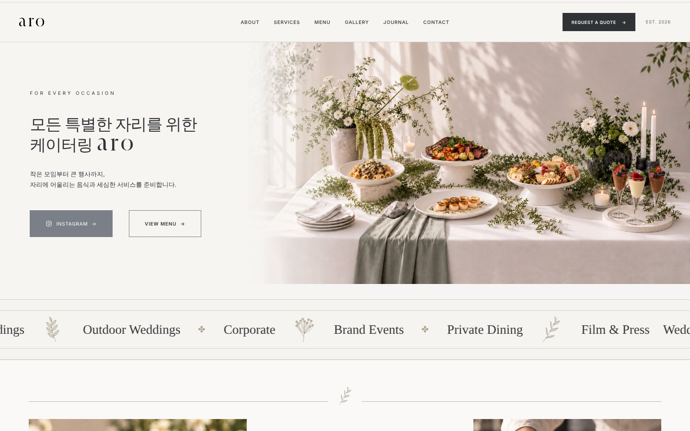
</p>

[](https://hyeran712.github.io/aro1/)


> 📑 슬라이드(16:9)로 보기: 아래 [슬라이드 펼쳐보기](#-슬라이드-펼쳐보기)에서 15장을 이미지로 볼 수 있고, PowerPoint 원본은 [`output/ARO_website_portfolio_summary.pptx`](./output/ARO_website_portfolio_summary.pptx)입니다.

| 페이지 | 메뉴 콘텐츠 | 갤러리 콘텐츠 | 문의 → 카카오톡 |
|:---:|:---:|:---:|:---:|
| **8개** | **13개** (3개 분류) | **14개** (5개 행사 유형) | **IP당 분당 3건** 제한 |

<sub>메뉴·갤러리 수치는 화면에 넣은 콘텐츠 항목 수이며, 실제 판매 상품 수나 행사 실적이 아닙니다.</sub>

---

## 📌 목차

1. [개요](#-개요)
2. [기획 배경](#-기획-배경)
3. [기술 스택과 배포 구조](#-기술-스택과-배포-구조)
4. [주요 기능](#-주요-기능)
5. [문의 알림 파이프라인](#-문의-알림-파이프라인)
6. [콘텐츠 표기 원칙](#-콘텐츠-표기-원칙)
7. [기술적 의사결정](#-기술적-의사결정)
8. [프로젝트 구조](#-프로젝트-구조)
9. [실행 방법](#-실행-방법)
10. [검증 결과](#-검증-결과)
11. [회고와 향후 계획](#-회고와-향후-계획)
12. [슬라이드 펼쳐보기](#-슬라이드-펼쳐보기)

---

## 🗂 개요

| 항목 | 내용 |
|---|---|
| **계기** | 지인이 웨딩 케이터링을 운영하는데 홈페이지가 없어, 실제로 쓸 사이트가 필요하겠다고 생각해 직접 만들었습니다. (현재 운영 준비 단계) |
| **목표** | 고객이 서비스 유형 · 메뉴 · 행사 분위기를 확인한 뒤 문의하고, 운영자는 문의를 카카오톡으로 바로 받도록 합니다. |
| **기획 대상** | 예비 부부 · 베뉴 운영자 · 행사 담당자 (서비스 설명과 문의 유형에서 정한 대상이며, 사용자 조사 결과는 아닙니다) |
| **규모** | 페이지 8개 · 메뉴 13개(PLATED · PASTA · SALAD) · 갤러리 14개(WEDDING · OUTDOOR · CORPORATE · BRAND EVENT · PRIVATE) · 진행 절차 4단계 · FAQ 7개 |
| **기간** | 2026.09 – 2026.10 |
| **개발** | hyeran712 — 기획 · 디자인 · 프론트엔드 · 문의 서버(Worker) · 배포 |
| **실행 환경** | 웹 [hyeran712.github.io/aro1](https://hyeran712.github.io/aro1/) (GitHub Pages) · 로컬 `http://localhost:3000` |

---

## 🎯 기획 배경

지인이 웨딩 케이터링을 운영하고 있지만 소개할 홈페이지가 없었습니다. 고객에게 메뉴와 행사 분위기를 보여 주고 문의를 받을 곳이 있으면 좋겠다고 생각해, **실제로 쓸 사이트**를 목표로 직접 만들기 시작했습니다.

만들면서 **고객 입장**(무엇을 먼저 보고 싶을까)과 **운영자 입장**(문의를 어떻게 바로 받을까)에서 세 가지 문제를 정리하고, 각각에 맞는 화면과 기능을 설계했습니다.

| # | 문제 | 상황 | 해결 |
|:---:|---|---|---|
| 01 | **음식과 분위기를 미리 보기 어렵다** | 케이터링은 맛과 테이블을 직접 보기 전까지 판단하기 어려움 | **사진 중심 메뉴 · 갤러리** — 카테고리 필터와 재료 설명 오버레이 |
| 02 | **상담 전에 궁금한 점이 많다** | 최소 인원, 시식, 진행 순서를 문의 전에 알고 싶어 함 | **FAQ · 4단계 진행 절차 · 서비스 유형 안내**를 문의 앞에 배치 |
| 03 | **문의가 와도 바로 알기 어렵다** | 정적 사이트(GitHub Pages)는 폼을 받아 줄 서버가 없음 | **Cloudflare Worker + 카카오톡 알림** — 키는 서버에만, 문의는 운영자 카카오톡으로 |

---

## 🛠 기술 스택과 배포 구조

| 구분 | 기술 |
|---|---|
| **Frontend** | React 19, React Router DOM 7, JavaScript, CSS, Create React App(react-scripts 5) |
| **문의 서버** | Cloudflare Workers, Workers KV(토큰 보관), Workers Rate Limiting(IP당 분당 3건) |
| **API** | Kakao 로그인(OAuth 토큰 갱신) · 카카오톡 메시지 API(나에게 보내기) |
| **Deploy** | GitHub Pages(gh-pages), Netlify 빌드 설정 지원, 빌드 후 공유 미리보기 주소 자동 설정 |

```text
브라우저 ──▶ GitHub Pages (React 정적 파일 · 8개 페이지)
              │  문의 폼 POST  (REACT_APP_INQUIRY_API_URL)
              ▼
           Cloudflare Worker  /inquiry ──▶ Rate Limiter (IP당 분당 3건)
              │                         ──▶ Workers KV (refresh_token · access_token)
              ├──▶ Kakao OAuth  (액세스 토큰 만료 1분 전 자동 갱신)
              └──▶ Kakao 메시지 API ──▶ 관리자 카카오톡 ‘나와의 채팅’
```

**문의 서버 요청**

| Method | 대상 | 설명 |
|---|---|---|
| OPTIONS | `/inquiry` | 브라우저 사전 요청(CORS), 허용된 사이트 주소만 통과 |
| POST | `/inquiry` | 문의 접수 → 검증 · 사용량 제한 → 카카오톡 전송 → `{ ok: true }` |
| POST | `kauth.kakao.com/oauth/token` | refresh token으로 액세스 토큰 갱신 (Worker 내부) |
| POST | `kapi.kakao.com/v2/api/talk/memo/default/send` | 관리자 카카오톡으로 문의 메시지 전송 (Worker 내부) |

---

## ✨ 주요 기능

### 1. 홈 — 브랜드 첫인상과 문의 진입

첫 화면에서 브랜드 메시지와 대표 사진을 보여 주고, 서비스 소개 · FAQ · 문의 버튼으로 이어집니다. 행사 유형(Weddings · Corporate · Brand Events · Private Dining…)은 흐르는 띠로 보여 줍니다.

<p align="center">
  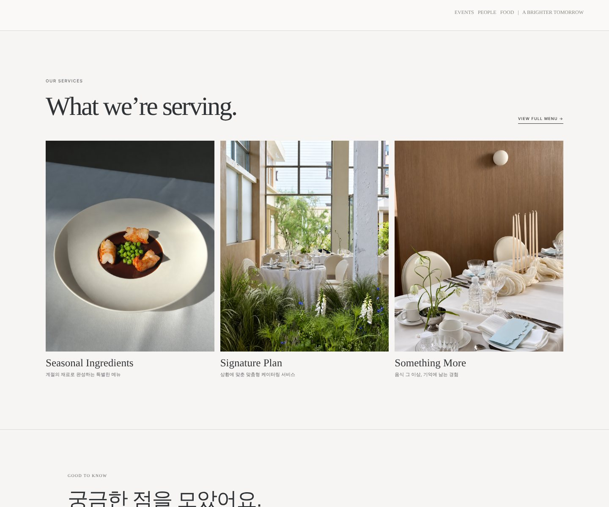
  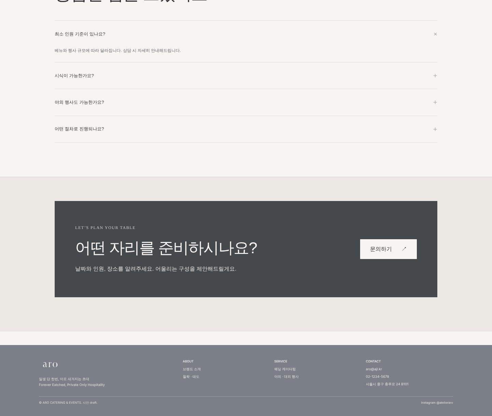
</p>

### 2. 메뉴 — 카테고리 필터와 재료 설명

13개 메뉴를 ALL · PLATED · PASTA · SALAD로 골라 봅니다. 사진에 마우스를 올리거나 키보드로 초점을 옮기면 재료 설명이 나타납니다.

```jsx
const [activeCategory, setActiveCategory] = useState("ALL");

const filteredItems =
  activeCategory === "ALL"
    ? menuItems
    : menuItems.filter((item) => item.category === activeCategory);
```

📄 [src/pages/Menu.jsx](src/pages/Menu.jsx)

<p align="center">
  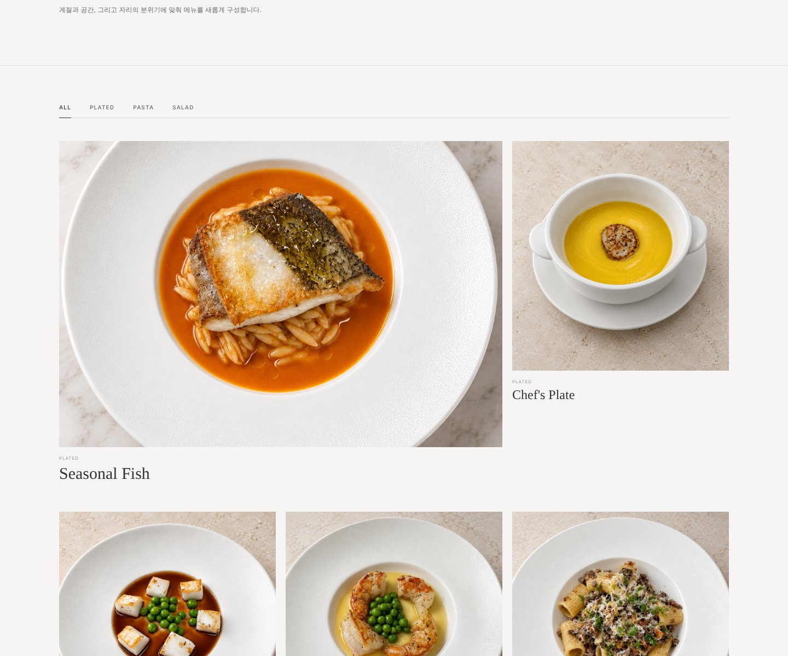
</p>

### 3. 갤러리 · 서비스 · 진행 절차

갤러리 14개 항목을 행사 유형 5가지로 거르고, 서비스 페이지에서 행사별 케이터링을, 진행 절차 페이지에서 상담부터 당일까지 4단계를 안내합니다.

<p align="center">
  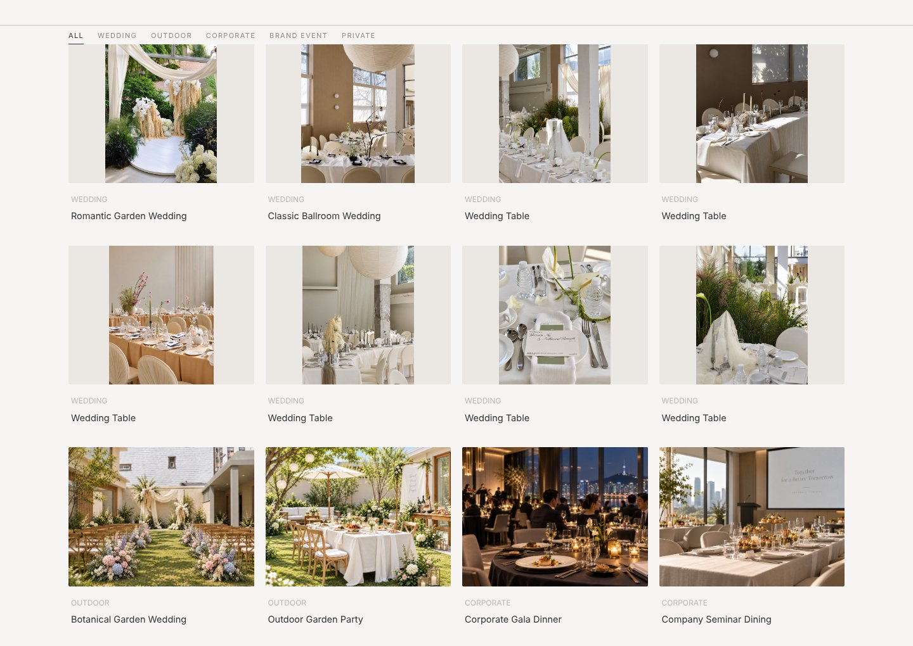
</p>
<p align="center">
  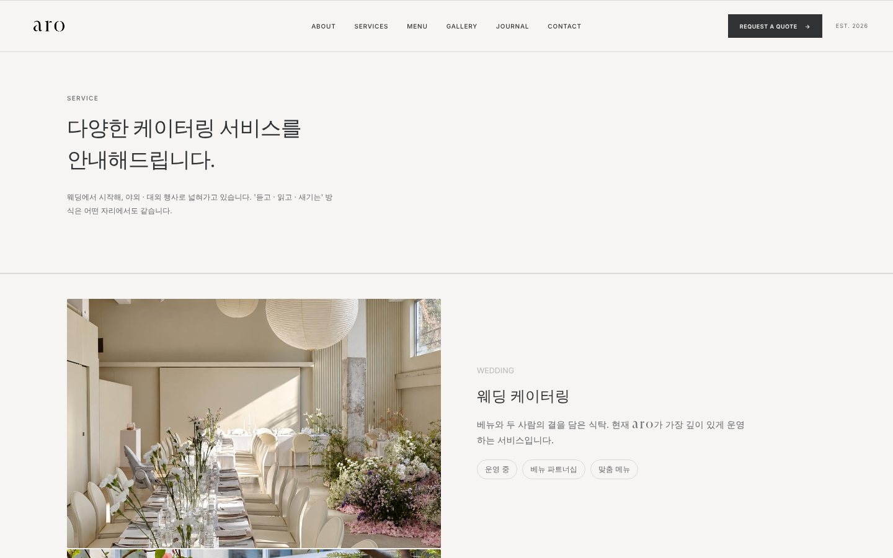
  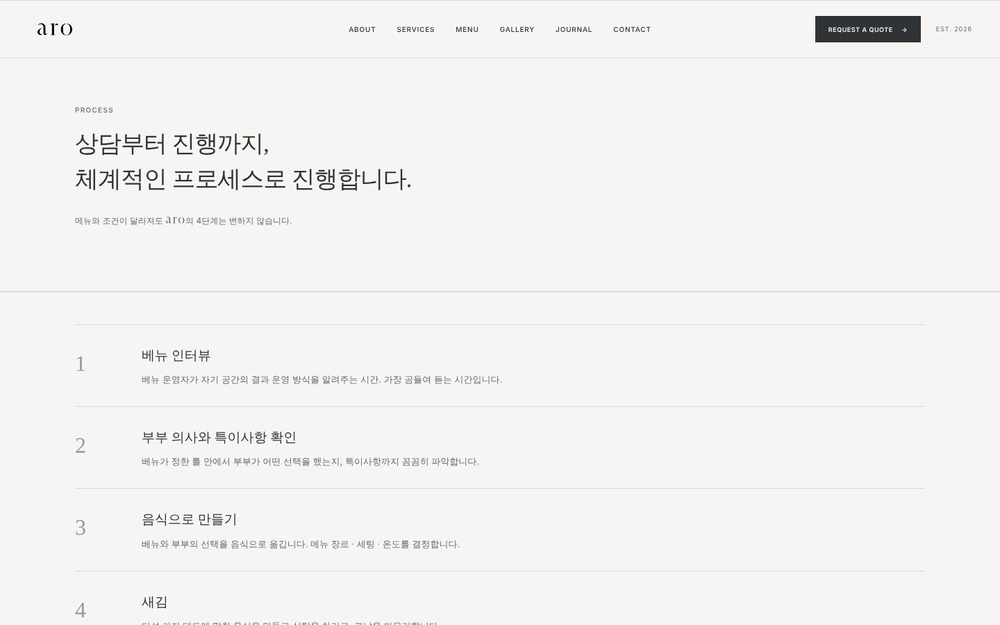
</p>

### 4. 모바일 대응

모바일에서는 햄버거 버튼으로 메뉴를 열고 닫으며, `aria-expanded`로 상태를 알리고 Escape 키로 닫을 수 있습니다.

<p align="center">
  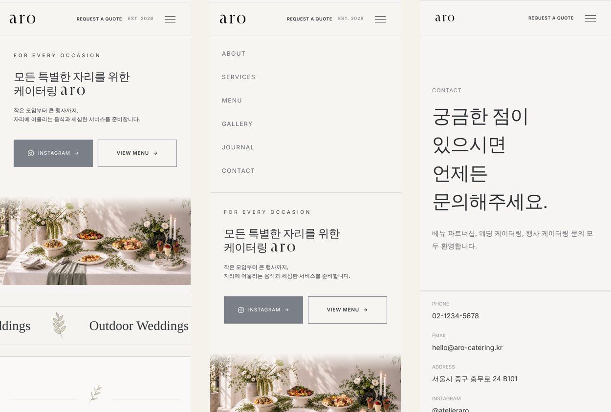
</p>

### 5. 견적 문의 → 카카오톡 알림

문의 유형 · 이름/소속 · 연락처 · 문의 내용을 받아 Worker로 보냅니다. **카카오톡 전송이 확인되어야** ‘문의가 접수되었습니다’를 띄우고, 실패하면 다시 시도하도록 안내합니다.

```jsx
const response = await fetch(endpoint, {
  method: 'POST', headers: { 'Content-Type': 'application/json' },
  body: JSON.stringify(form), signal: AbortSignal.timeout(20000),
});
const result = await response.json();
if (!response.ok || result.ok !== true) throw new Error('send failed');
setSubmitted(true);
```

📄 [src/pages/Contact.jsx](src/pages/Contact.jsx) · [server/kakao/worker.mjs](server/kakao/worker.mjs)

<p align="center">
  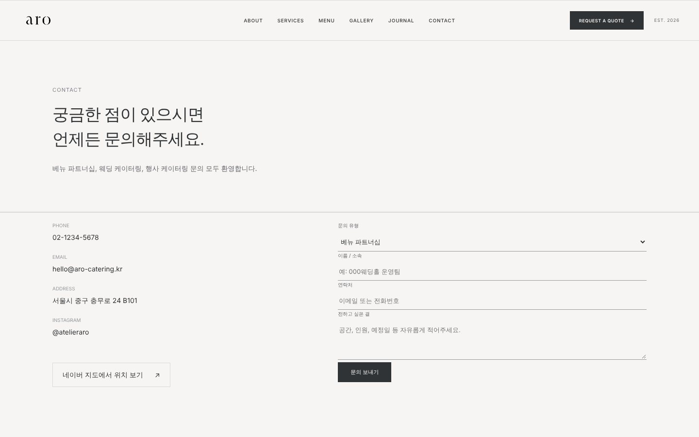
</p>

---

## 🔔 문의 알림 파이프라인

<p align="center">
  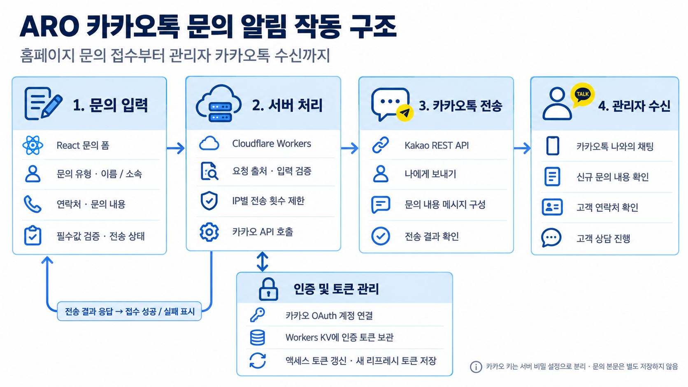
</p>

```text
① 출처 확인        ② 형식 검증              ③ 사용량 제한        ④ 토큰 확보               ⑤ 카카오 전송            ⑥ 응답
Origin 일치 여부 → JSON · 5,000자 이하   → IP당 분당 3건    → KV의 refresh token     → 나에게 보내기          → 200 접수 완료
아니면 403         필드 길이 · 문의 유형     넘으면 429          만료 1분 전 자동 갱신      result_code 0 확인       실패 시 502 · 재시도 안내
```

| 보호 장치 | 내용 |
|---|---|
| **출처 확인** | 허용한 사이트 주소(`ALLOWED_ORIGIN`)에서 온 요청만 처리하고, 나머지는 403 |
| **입력 검증** | JSON만 받고(415), 본문 5,000자 초과는 413. 유형 40자 · 이름 80자 · 연락처 120자 · 내용 600자, 문의 유형은 4가지만 허용 |
| **사용량 제한** | 같은 IP는 분당 약 3건, 넘으면 429 |
| **키 관리** | 카카오 REST API 키와 시크릿은 Worker 비밀 설정에만, 토큰은 Workers KV에만 보관. React 빌드에는 공개 문의 주소만 들어감 |
| **토큰 갱신** | 액세스 토큰이 만료 1분 전이면 자동 갱신하고, 새 refresh token이 오면 KV에 저장 |
| **개인정보** | 문의 본문과 토큰은 로그에 남기지 않고 따로 저장하지 않음 |
| **시간 제한** | 카카오 요청마다 8초, 브라우저 요청 20초 |

---

## 🧭 콘텐츠 표기 원칙

브랜드 사이트이지만 실제 운영 전 단계라, 화면 문구가 사실보다 앞서 나가지 않도록 같은 기준을 지켰습니다.

| 원칙 | 할 수 있는 말 ✅ | 할 수 없는 말 ❌ |
|---|---|---|
| 콘텐츠 수는 실적이 아님 | “메뉴 13개를 4가지 필터로 볼 수 있다” | “13가지 상품을 판매 중이다” |
| 접수 완료는 전송 확인 후 | “카카오톡 전송이 확인되면 접수 완료” | “버튼을 누르면 바로 접수 완료” |
| 준비 중인 서비스는 준비 중 | “야외 · 대외 행사는 순차 준비 중” | “모든 행사를 지금 바로 진행한다” |
| 사진은 분위기 연출 | “행사 분위기를 보여 주는 이미지” | “ARO가 진행한 실제 행사 사진” |
| 문의는 알림으로만 전달 | “문의 내용은 운영자 카카오톡으로 전달” | “문의 내역을 사이트에서 관리한다” |

---

## 💡 기술적 의사결정

| 항목 | 채택 | 검토 대안 | 이유 |
|---|---|---|---|
| **문의 서버** | Cloudflare Workers | 외부 폼 서비스 · 자체 서버 | 정적 사이트(GitHub Pages)를 그대로 두고, 키를 브라우저에 노출하지 않으며 무료 사용량 안에서 운영할 수 있습니다. |
| **알림 채널** | 카카오톡 나에게 보내기 | 이메일 알림 | 운영자가 가장 자주 확인하는 채널이라 새 문의를 놓치지 않고, 추가 앱이 필요 없습니다. |
| **토큰 관리** | KV + refresh token 자동 갱신 | 액세스 토큰 고정 | 액세스 토큰은 금방 만료되므로, 갱신된 토큰을 KV에 저장해 재배포 없이 계속 동작합니다. |
| **남용 방지** | Origin 검사 + IP당 분당 3건 | 처음부터 캡차 도입 | 소규모 운영에 맞는 최소 장치로 시작하고, 스팸이 생기면 Turnstile을 추가합니다. |
| **접수 완료 기준** | 카카오 전송 성공 후 표시 | 요청을 보내자마자 표시 | 고객은 접수됐다고 믿는데 운영자는 못 받는 상황을 막습니다. |
| **라우팅** | BrowserRouter + `404.html` 복사 | HashRouter | 깔끔한 주소를 유지하면서 GitHub Pages 새로고침 404를 빌드 후처리로 해결했습니다. |
| **문의 저장** | 저장하지 않음 | DB 저장 | 개인정보 보관 부담을 줄이고, 소규모 운영에서는 카카오톡 알림만으로 충분합니다. |

---

## 📂 프로젝트 구조

```text
src/
  App.js                    # 8개 경로 + 404
  index.js                  # BrowserRouter (배포 주소에 맞춘 basename)
  pages/                    # Home, About, Service, Menu, Gallery, Process, Journal, Contact
  components/               # Header(모바일 메뉴), Footer, BrandText, PhotoSlot, OccasionIcon
  index.css · pages/*.css   # 아이보리 · 실버 · 차콜 디자인
public/
  images/                   # menu, gallery, services, journal, 로고
server/kakao/
  worker.mjs                # 문의 접수 · 검증 · 제한 · 토큰 갱신 · 카카오 전송
  wrangler.toml             # Worker 이름, 허용 주소, KV, 사용량 제한 설정
  connect.mjs               # 처음 한 번 카카오 계정을 연결해 refresh token 발급
  README.md                 # 카카오 · Cloudflare 설정 방법
scripts/finalize-build.cjs  # 빌드 후 공유 미리보기 주소 설정, 404.html 생성
docs/images · docs/slides   # README 화면 캡처와 슬라이드 이미지
output/                     # 포트폴리오 PPT
```

---

## 🚀 실행 방법

Node.js 18 이상이 필요합니다.

```bash
git clone https://github.com/hyeran712/aro1.git
cd aro1
npm install
npm start            # http://localhost:3000
npm run build        # build/ 생성 + 공유 미리보기 주소 설정
npm run deploy       # GitHub Pages 배포
```

### 문의 서버 (Cloudflare Worker)

카카오 앱 · Cloudflare 설정과 토큰 연결 방법은 [server/kakao/README.md](server/kakao/README.md)에 정리했습니다.

| 설정 | 위치 | 용도 |
|---|---|---|
| `REACT_APP_INQUIRY_API_URL` | `.env.production` | 사이트가 문의를 보낼 Worker 주소 (공개 값) |
| `KAKAO_CLIENT_ID` · `KAKAO_CLIENT_SECRET` | Worker 비밀 설정 | 카카오 토큰 갱신용 키 |
| `recipient` | Workers KV | 받는 사람의 refresh token |
| `ALLOWED_ORIGIN` · `SITE_URL` | `wrangler.toml` | 허용할 사이트 주소, 메시지 버튼 링크 |

---

## ✅ 검증 결과

### 2026.10.30 확인

| 검사 | 결과 |
|---|---|
| 프로덕션 빌드 `npm run build` | 통과 (Compiled successfully), 공유 미리보기 주소 설정 완료 |
| 8개 경로 화면 표시 | 로컬 빌드에서 8개 페이지 모두 표시 확인 (README 캡처) |
| 모바일 메뉴 | 390px 화면에서 열기 · 닫기 확인 |
| 문의 → 카카오톡 수신 | 운영 사이트에서 실제 문의 전송, ‘나와의 채팅’ 수신과 접수 완료 표시 확인 |
| 의존성 설치 | `npm ci`는 package-lock 불일치로 실패, `npm install`로 설치 |

- **검증하지 않은 범위**: 여러 사람이 동시에 보내는 부하, 토큰이 완전히 만료된 뒤 재연결 흐름, 접근성 전수 점검, 모든 화면 크기의 픽셀 비교.

---

## 📈 회고와 향후 계획

**잘한 점 (Keep)**
- **정적 사이트에 서버 기능 더하기** — GitHub Pages를 그대로 두고 Worker 하나로 실제 문의 접수를 연결했습니다.
- **키를 브라우저에 두지 않기** — 빌드에는 공개 주소만, 키와 토큰은 서버 비밀 설정과 KV에만 보관했습니다.
- **고객 입장의 접수 완료** — 카카오 전송이 확인될 때만 완료를 띄워, 놓치는 문의가 없도록 했습니다.
- **사진 중심 브랜드 표현** — 메뉴와 갤러리를 필터로 골라 보며 분위기를 먼저 느끼게 했습니다.

**아쉬운 점 (Problem)**
- 문의 목록을 따로 저장하지 않아, 지난 문의를 사이트에서 다시 볼 수 없습니다.
- 오래 문의가 없거나 동의를 철회하면 카카오 계정을 다시 연결해야 합니다.
- 방문 · 문의 전환을 측정하는 자료가 아직 없습니다.
- package-lock이 package.json과 맞지 않아 `npm ci`가 실패합니다.

**다음 단계 (Try)**
1. **스팸 방지** — Turnstile 같은 추가 검증 도입
2. **관리자 문의 목록** — 문의 기록 확인 화면
3. **전환 측정** — 메뉴 탐색과 문의 성공 이벤트 기록
4. **운영 준비** — 실제 연락처 · 메뉴 조건 · 이미지 사용 권한 확인
5. **Journal 상세 페이지**와 package-lock 정리

---

## 📊 슬라이드 펼쳐보기

프로젝트 전체 내용을 16:9 슬라이드 15장으로 정리했습니다. 원본은 [`output/ARO_website_portfolio_summary.pptx`](./output/ARO_website_portfolio_summary.pptx)이며, 아래 이미지는 같은 슬라이드를 내보낸 것입니다.

<details open>
<summary><b>📂 슬라이드 펼쳐보기 (총 15장)</b></summary>
<br />

<p align="center">
  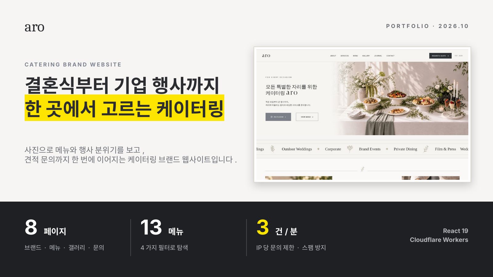<br /><sub>01 · 표지</sub><br /><br />
  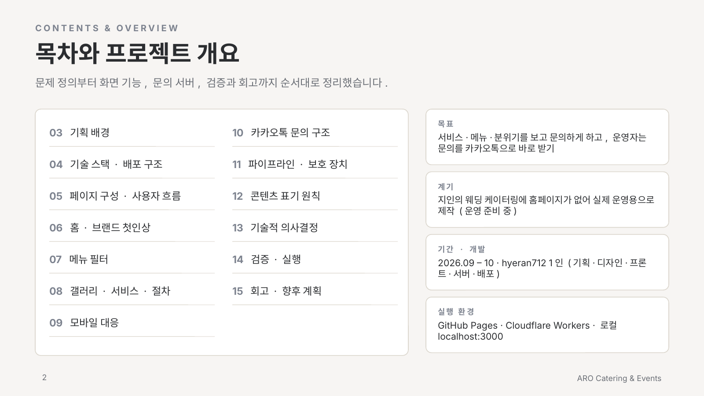<br /><sub>02 · 목차와 프로젝트 개요</sub><br /><br />
  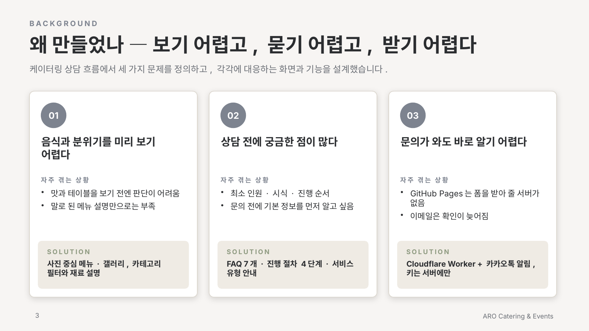<br /><sub>03 · 기획 배경</sub><br /><br />
  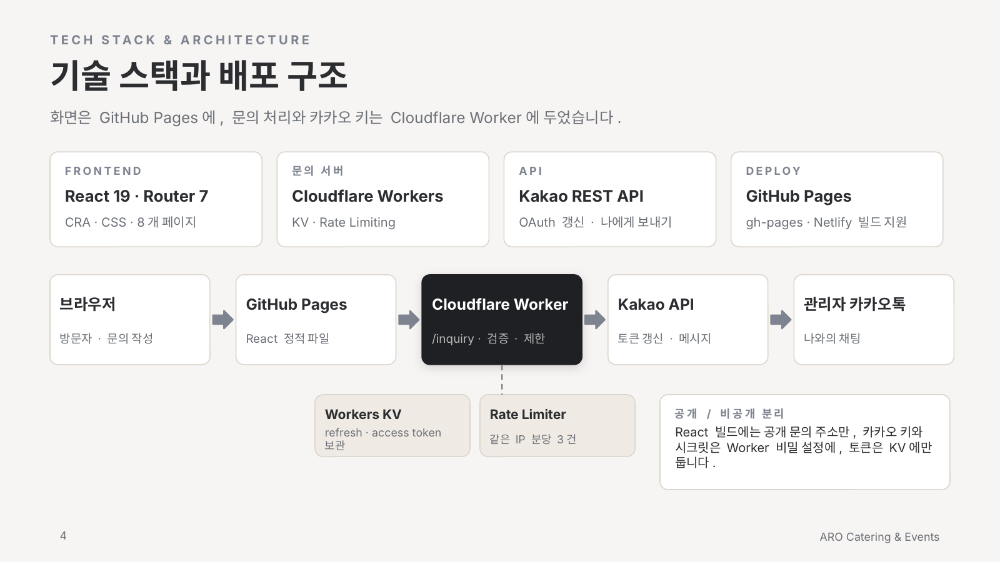<br /><sub>04 · 기술 스택과 배포 구조</sub><br /><br />
  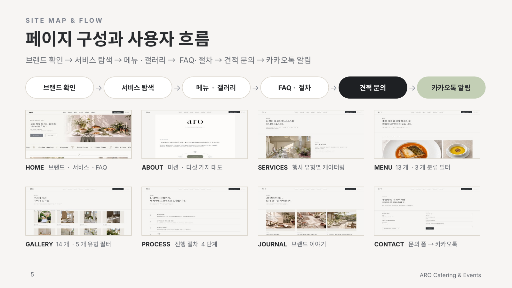<br /><sub>05 · 페이지 구성과 사용자 흐름</sub><br /><br />
  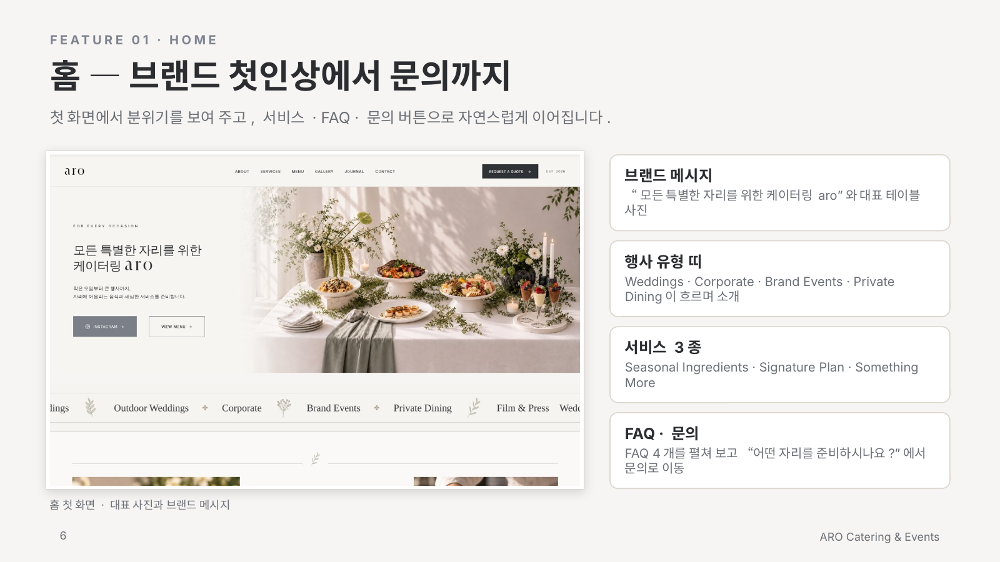<br /><sub>06 · 홈 · 브랜드 첫인상</sub><br /><br />
  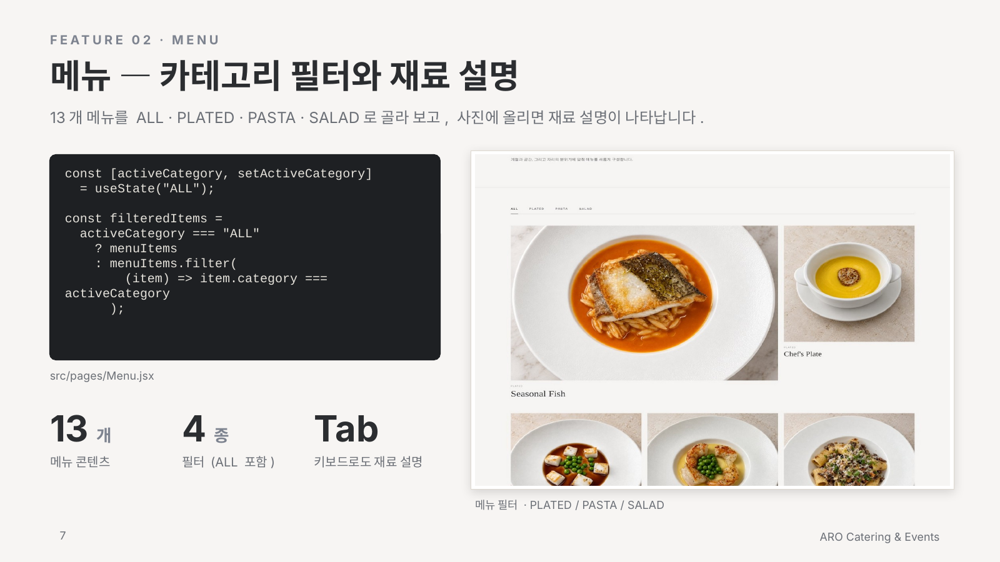<br /><sub>07 · 메뉴 필터와 재료 설명</sub><br /><br />
  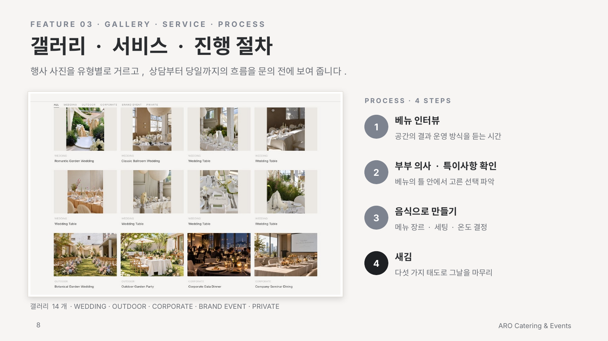<br /><sub>08 · 갤러리 · 서비스 · 진행 절차</sub><br /><br />
  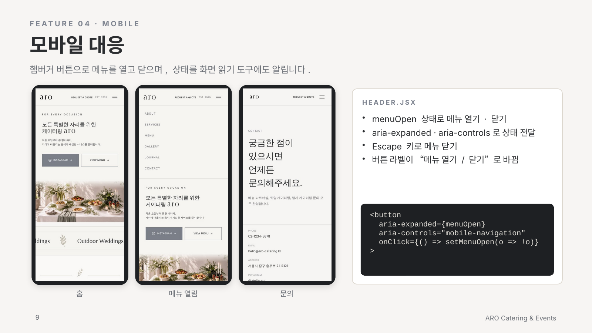<br /><sub>09 · 모바일 대응</sub><br /><br />
  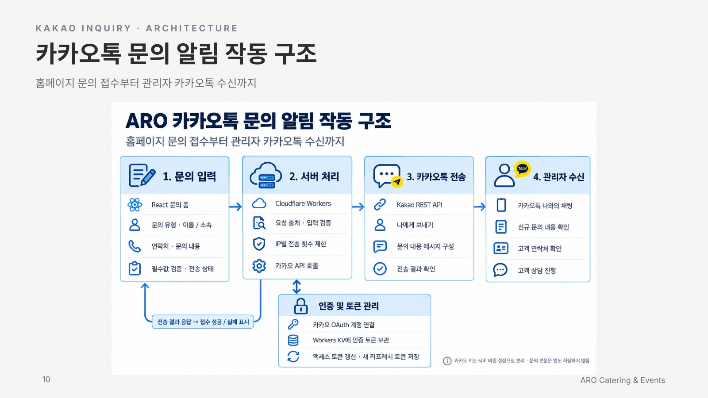<br /><sub>10 · 카카오톡 문의 알림 구조</sub><br /><br />
  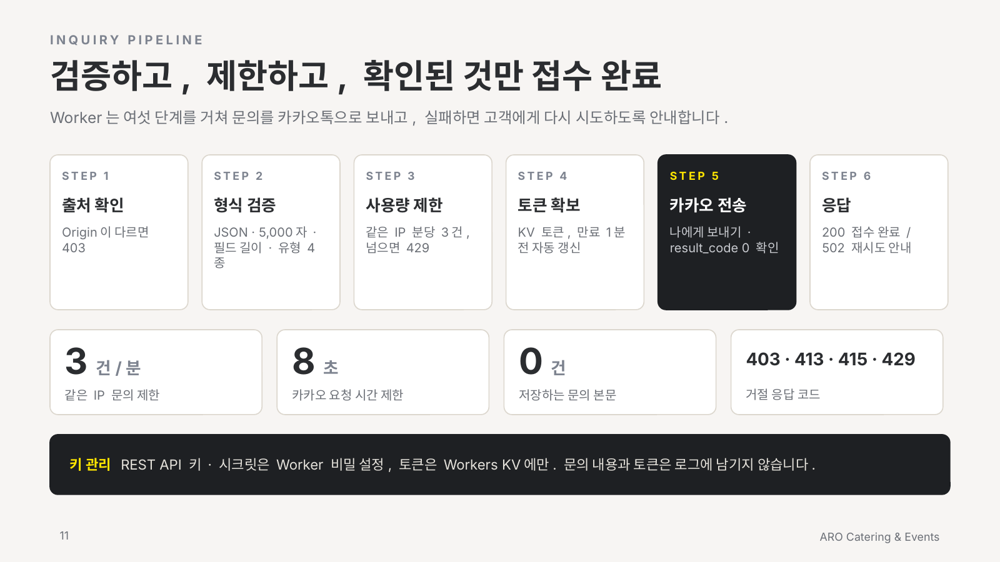<br /><sub>11 · 문의 파이프라인과 보호 장치</sub><br /><br />
  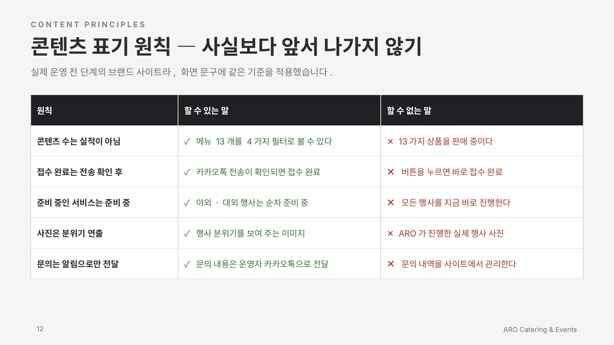<br /><sub>12 · 콘텐츠 표기 원칙</sub><br /><br />
  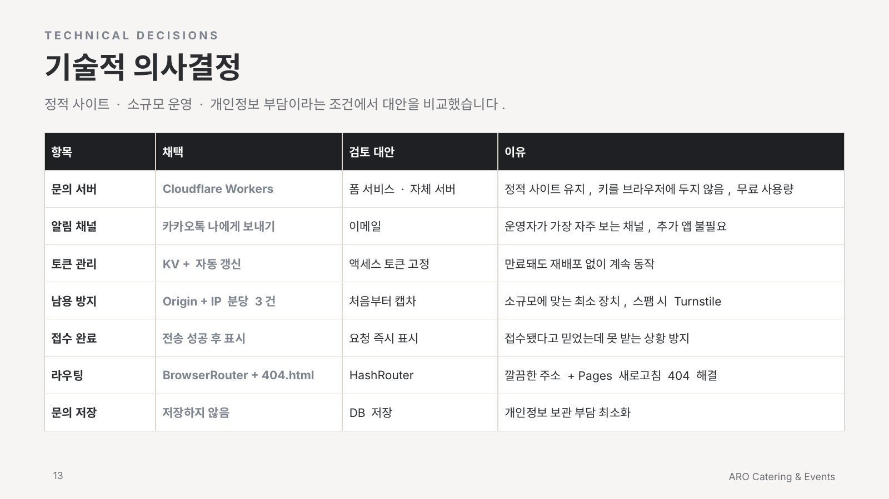<br /><sub>13 · 기술적 의사결정</sub><br /><br />
  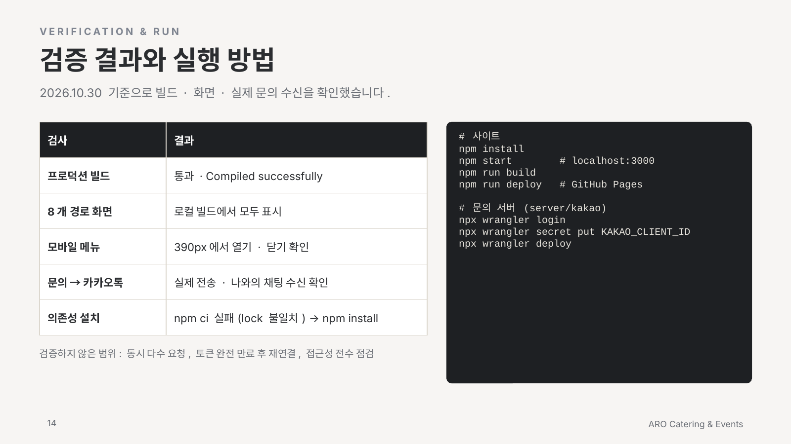<br /><sub>14 · 검증 결과와 실행 방법</sub><br /><br />
  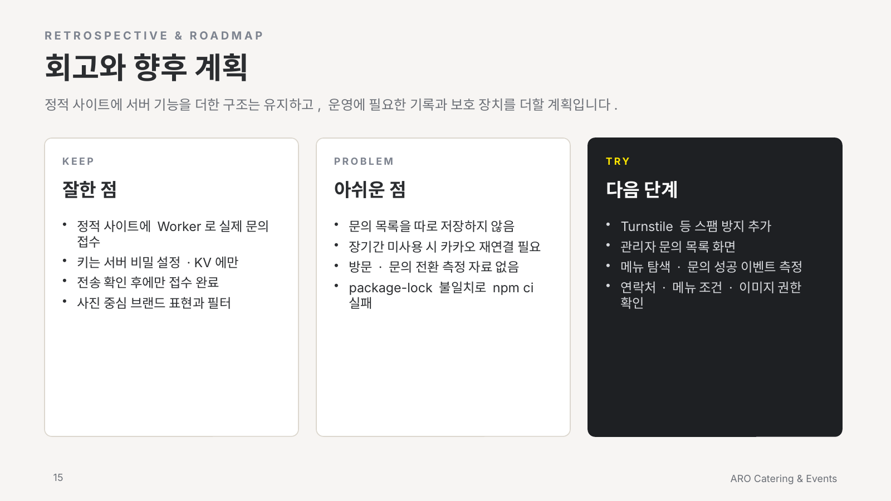<br /><sub>15 · 회고와 향후 계획</sub><br /><br />
</p>

</details>

---

<sub>ARO Catering & Events · hyeran712 · 2026</sub>
